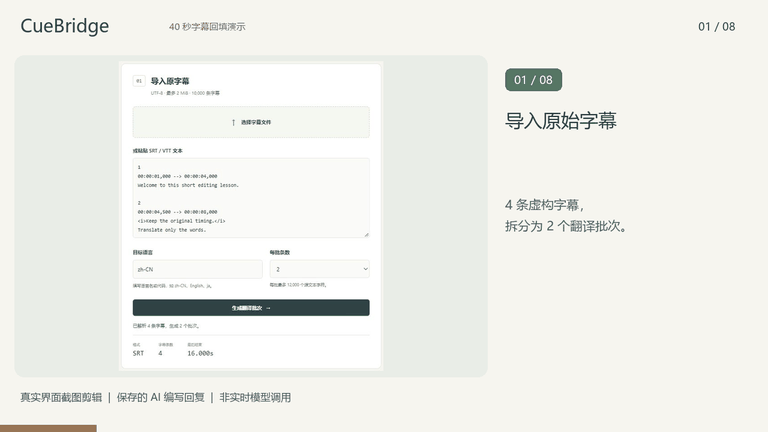

# CueBridge 字幕翻译回填

[English](README.md) · [简体中文](README.zh-CN.md)

**将 SRT 或 WebVTT 文本交给你选择的 AI 翻译，再按原时间轴回填译文。**

CueBridge 是浏览器本地的翻译交接工具：按固定 ID 导出字幕批次，校验带回的 JSON，只替换字幕正文。不调用模型，也不自动翻译。中英文界面分为独立页面。

[中文应用](https://nyxorbithq.github.io/subtitle-roundtrip/) · [英文应用](https://nyxorbithq.github.io/subtitle-roundtrip/en.html) · [使用说明](docs/USAGE.zh-CN.md)

## 观看操作演示

[40 秒演示与素材下载](docs/DEMO.zh-CN.md)



真实界面截图剪辑，使用保存的 AI 编写回复，非实时模型调用。本次修改合并且 Pages 部署成功后，演示页才会上线。

## 体验完整流程

1. 打开 `dist/index.html`，或启动下方本地服务器。
2. 点击「试用 SRT 示例」或「试用 VTT 示例」，四条虚构字幕会分为两批。
3. 点击「填入示例译文」，再点击「校验并接受本批」。
4. 选择第二批并重复操作。两批通过后才能「下载译后字幕」。

示例译文是人工预置的中文，不会联系 AI 服务。处理自己的文件时，复制各批提示词到自选 AI 服务，再粘贴或导入它返回的 JSON。关闭页面前请保存已接受的回复文件。

## 保留与校验范围

- 保留原编号、标识、时间行、位置设置、块分隔符，以及正文之外的 VTT 文件头、NOTE、STYLE 和 REGION 内容。
- 校验原文件指纹、批次、目标语言、完整且不重复的 ID、未改动的 `source` 字段，以及非空译文。
- 原有标签、内嵌时间戳和样式标记必须原样且按原顺序保留。阻止新增标签、空行和正文中的时间箭头。
- 导出前重新校验全部批次，不生成缺批次的部分字幕。

仅支持 UTF-8。原字幕和输出上限 2 MiB，回复上限 4 MiB；最多 10,000 条字幕，每条最多 10,000 字符；每批 1—100 条、最多 12,000 个源文本字符。仅支持保守的 SRT／WebVTT 子集，不是完整格式校验器或字幕编辑器。见[格式与回填协议](docs/FORMAT.zh-CN.md)。

结构校验不代表译文正确或阅读速度合适。请在播放器中复查；保留原标记不等于验证了全部渲染语义。

## 数据边界

不上传文件，不使用账号、API Key、埋点、模型调用或浏览器持久历史；CSP 限制网络连接。复制到外部 AI 服务后，文本将交给该服务处理，请使用获授权的材料并确认其规则。SHA-256 用于识别原文件，不是加密或签名。见[数据边界](SECURITY.zh-CN.md)。

## 本地开发

需要 Node.js 20+，无需安装依赖。

```powershell
npm.cmd run check
npm.cmd start
```

打开打印的 `http://127.0.0.1:4180`。端口占用时使用 `npm.cmd start -- --port 4181`；macOS／Linux 将 `npm.cmd` 换成 `npm`。服务器只在本机提供固定白名单中的应用、演示页和媒体文件；MP4 支持单段字节范围请求以便跳转播放。修改 `src/` 后重新构建，连同 `dist/` 和虚构示例一起提交。CI 覆盖 Ubuntu／Windows、Node 20／22／24。

[文档目录](docs/README.zh-CN.md) · [验证记录](docs/VALIDATION.zh-CN.md) · [贡献指南](CONTRIBUTING.zh-CN.md) · [MIT 许可证](LICENSE)
